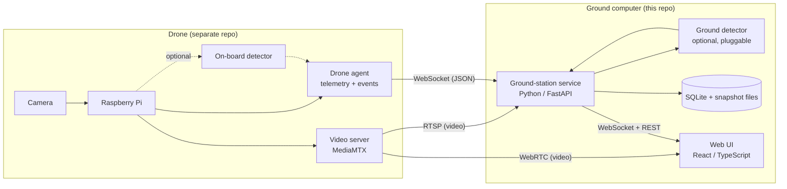

# Drone-UI Design Plan

Ground-station frontend for a perimeter-surveillance drone. The drone carries a Raspberry Pi that streams live video over Wi-Fi and may run on-board image processing. This repo owns everything on the **ground side** of that Wi-Fi link: receiving the stream, displaying it, receiving or producing detections, and logging them for review.

Flight control, autopilot, path planning, and the Pi's on-board software are implemented in a separate repo. This repo only depends on them through the interface contract defined in [Interface contract](#5-interface-contract-drone--ground).

---

## 1. Goals and non-goals

### Goals

1. Show the drone's live camera feed with low latency (target under 500 ms glass-to-glass).
2. Show live drone status: link health, battery, position or altitude if available, mission state.
3. Receive **detections**, meaning objects or conditions flagged as either:
   - **Security risks**, such as people, vehicles, an open gate, fence breaches, or unknown objects near the perimeter.
   - **Maintenance issues**, such as damaged fencing, debris, vegetation overgrowth, broken lights, standing water, or corrosion.
4. Log every detection persistently with a snapshot, timestamp, location, confidence, and where it was produced. Operators can review, acknowledge, dismiss, or mark detections as false positives.
5. Stay **agnostic about where image processing runs**. It could run on the Pi, on the ground computer, or split between them, and that decision has not been made yet.
6. Be developable and testable without the real drone, using a simulator.

### Non-goals (for now)

- Flying or steering the drone. The UI may send a small set of non-flight commands, such as starting a recording or changing the processing mode, but it is not a flight controller.
- Training detection models. Models are consumed here, not built here.
- Cloud or multi-site deployment. This is a local, single-site ground station.

---

## 2. System overview



The system has three pieces:

1. **Drone side (out of scope, contract only).** The Pi runs a video server and a small "drone agent" process. The agent publishes telemetry and, if on-board detection is enabled, detection events.
2. **Ground-station service (this repo, `ground-station/`).** A local backend that connects to the drone, normalizes everything it receives, optionally runs ground-side detection on the video, persists the detection log, and serves the UI.
3. **Web UI (this repo, `web/`).** A browser app that plays the video directly from the drone and gets all structured data (telemetry and detections) from the ground-station service.

### Why have a ground-station service instead of a browser-only app?

A pure browser app talking straight to the Pi would be simpler, but:

- Detections need to be **persisted** even if the browser tab is closed or refreshed.
- If processing ends up on the ground computer, something has to decode the video and run a model. Python with OpenCV, Ultralytics, or ONNX Runtime is the natural fit, and a browser is not.
- It isolates the UI from the Pi's protocol. If the drone team changes their messages, only the adapter in the service changes.
- It allows multiple viewers, such as a second laptop or a tablet, without each one opening its own connection to the Pi over a constrained Wi-Fi link.

Video is the exception. The UI plays it **directly from the Pi** so it doesn't pick up the extra latency of a relay hop.

---

## 3. Video transport

The browser can't play RTSP or raw H.264 sockets, so the protocol choice matters. Options considered:

| Option | Latency | Bandwidth (720p30) | Browser support | Notes |
|---|---|---|---|---|
| **WebRTC (WHEP)** | ~150–400 ms | 2–4 Mbps (H.264) | Native | Recommended. |
| MJPEG over HTTP | ~100–300 ms | 10–25 Mbps | Native (``) | Simplest; good fallback and for early bring-up. Bandwidth-heavy over Wi-Fi. |
| HLS / LL-HLS | 1–6 s | Low | Native / hls.js | Too much latency for live surveillance. |
| RTSP | Low | Low | None | Fine for the ground-station service and processing, not for the browser. |

**Recommendation:** run [MediaMTX](https://github.com/bluenviron/mediamtx) on the Pi with its native Raspberry Pi camera source. One H.264 encode gets served as:

- **WebRTC (WHEP)** to the browser for low-latency viewing.
- **RTSP** to the ground-station service if ground-side processing is enabled.

The UI's video component will support **WebRTC as primary and MJPEG as fallback**, selected by configuration. This lets early bring-up work even before WebRTC is configured on the Pi.

### Hardware considerations for the drone team

- **Pi 4** has a hardware H.264 encoder, which keeps encoding cheap.
- **Pi 5 has no hardware H.264 encoder.** Encoding happens in software, which is fine at 720p30 but takes CPU away from on-board detection. This affects the on-board versus ground processing decision.

### Bounding-box overlays

There are two ways to show detection boxes on the video:

1. **Client-side overlay (default).** Detections carry normalized bounding boxes and a frame timestamp. The UI draws them on a `<canvas>` over the `<video>` and fades them out after about 1 s. Alignment won't be frame-perfect, but it's good enough for an operator and costs no extra bandwidth.
2. **Annotated stream (optional).** Whichever side runs the detector publishes a second stream with boxes burned in. This gives perfect alignment but doubles encoding cost. The UI can switch between raw and annotated streams if one is available.

---

## 4. Image processing: on-board, ground, or hybrid

Where detection runs is undecided, so the design treats **detection sources as pluggable** and normalizes all of them into one `Detection` schema (see section 5). The UI and the log never care where a detection came from, except to display a `source` tag.

### Supported modes

| Mode | Where inference runs | Pros | Cons |
|---|---|---|---|
| `onboard` | Pi | Works even when the video link is degraded; only small events cross the link. | Limited compute: a Pi 4 CPU runs a nano-size model at only a few FPS. Pi 5 + Hailo AI Kit or a Coral TPU changes this a lot. |
| `ground` | Ground computer | Much more compute (GPU possible), bigger and more accurate models, easy to iterate. | Depends on video quality over Wi-Fi; compression artifacts and dropped frames hurt accuracy. |
| `hybrid` | Pi pre-filters, ground confirms | Cheap detector on the Pi flags candidates, and the ground runs a heavier model on full-res snapshots. | Most complex to implement. |
| `off` | None | Video and telemetry only. | No detections. |

### How this repo supports each mode

- **`onboard`:** the ground-station service just ingests `detection` messages from the drone agent and fetches their snapshots.
- **`ground`:** the service pulls the RTSP stream, samples frames at a configurable rate (for example 5 FPS), and runs them through a `Detector` interface:

  ```python
  class Detector(Protocol):
      name: str
      def detect(self, frame: np.ndarray, ts: float) -> list[RawDetection]: ...
  ```

  Implementations live in `ground-station/app/inference/` and are selected by config. Model weights are not committed.
- **`hybrid`:** on-board detections arrive marked `status: "candidate"`. The ground detector re-evaluates the attached snapshot and either promotes it to `confirmed` or drops it.

The active mode is a runtime setting, shown in the UI and changeable from the settings page. The drone agent should expose a command to enable or disable its own detector.

### Detection post-processing (same for all sources)

- **Classification into categories.** A configurable mapping from model class labels to `security` or `maintenance`, plus a severity level. For example, `person` maps to security/high and `debris` maps to maintenance/low.
- **De-duplication.** The same object seen across many frames should produce one log entry, not hundreds. Use a simple tracker such as IoU matching within a time window, or ByteTrack if it's available from the detector, and update the existing entry instead of creating a new one.
- **Confidence thresholds** per class, configurable.
- **Zones (later).** Optional polygons defining "inside perimeter" or ignore regions, applied when position data allows it.

---

## 5. Interface contract (drone ↔ ground)

This is the main dependency on the drone repo. It will be written as JSON Schema in `contracts/` and shared with the drone team, with a human-readable version in `docs/PROTOCOL.md`.

### Network

- Default assumption: the **Pi runs as a Wi-Fi access point** (WPA2) and the ground computer joins it, giving fixed IPs (for example Pi at `192.168.4.1`). Joining an existing site network also works if the Pi has a static IP or mDNS name (`drone.local`).
- The **Pi has no real-time clock**, so the ground computer should act as its NTP/chrony server. Synchronized clocks matter for lining up detections with video and for an accurate log.

### Endpoints exposed by the Pi

| Purpose | Transport | Example |
|---|---|---|
| Live video (browser) | WebRTC / WHEP | `http://drone.local:8889/cam/whep` |
| Live video (processing) | RTSP | `rtsp://drone.local:8554/cam` |
| Fallback video | MJPEG over HTTP | `http://drone.local:8080/stream.mjpg` |
| Events and telemetry | WebSocket (JSON) | `ws://drone.local:8765/v1/events` |
| Snapshots | HTTP GET | `http://drone.local:8765/v1/snapshots/{id}.jpg` |

### Message envelope

Every WebSocket message uses the same envelope:

```json
{
  "v": 1,
  "type": "telemetry",
  "seq": 10423,
  "ts": "2026-10-21T20:51:03.120Z",
  "payload": { }
}
```

- `v` is the protocol version, so either side can reject versions it doesn't understand.
- `seq` increases monotonically per session. It lets the ground detect gaps and request a replay.

### Message types

**Drone to ground**

- `hello`: sent on connect. Contains drone ID, firmware/agent version, camera resolution, available streams, on-board detector availability, and the class list.
- `heartbeat`: sent at 1 Hz. Used for link-loss detection.
- `telemetry`: sent at 1–5 Hz. Battery %, voltage, flight mode, mission state, altitude, heading, GPS or local position if available, Wi-Fi RSSI, CPU temperature and load.
- `detection`: a single detection (schema below).
- `status`: mission or state changes, such as `mission_started`, `waypoint_reached`, `returning_home`, `landed`, or errors.

**Ground to drone**

- `ack`: acknowledges detections by `seq` so the Pi can drop them from its outbound buffer.
- `command`: a small, non-flight set only, such as `set_onboard_detection {enabled}`, `start_recording`, `stop_recording`, `capture_snapshot`, or `replay_from {seq}`.

### Detection schema

```json
{
  "id": "det_01JB8Z...",
  "source": "onboard",
  "detector": "yolov8n-perimeter@0.3",
  "status": "confirmed",
  "category": "security",
  "label": "person",
  "severity": "high",
  "confidence": 0.87,
  "bbox": { "x": 0.41, "y": 0.22, "w": 0.08, "h": 0.31 },
  "frame_ts": "2026-10-21T20:51:02.980Z",
  "track_id": "trk_17",
  "position": { "lat": 0.0, "lon": 0.0, "alt_m": 25.0 },
  "heading_deg": 182.0,
  "snapshot_url": "/v1/snapshots/det_01JB8Z.jpg",
  "notes": null
}
```

- `source` is `onboard` or `ground`. `status` is `candidate` or `confirmed`.
- `bbox` uses normalized coordinates (0–1), so it is independent of resolution.
- `position` is optional and may be null if the drone has no GPS.
- Ground-produced detections use the same schema.

### Link loss and reliability

- If no heartbeat arrives for 3 s, the UI shows **link degraded**. After 10 s it shows **link lost**.
- The Pi **buffers unacknowledged detections** (store-and-forward) and resends them on reconnect. The ground de-duplicates by `id`.
- Both the ground service and the UI reconnect automatically with exponential backoff.

---

## 6. Ground-station service (`ground-station/`)

**Stack:** Python 3.11+, FastAPI, Uvicorn, `websockets`/`httpx` for the drone link, SQLite via SQLModel or SQLAlchemy, OpenCV or PyAV for frame grabbing in ground mode.

### Modules

- `link/`: drone connection. WebSocket client to the drone agent, reconnect and backoff, sequence-gap detection, acks, snapshot fetching. Contains the **protocol adapter**, the only code that knows the drone's wire format.
- `inference/`: optional ground-side detection. A frame grabber (RTSP), the `Detector` interface, and model implementations. Disabled by default.
- `detections/`: the normalization pipeline (category mapping, thresholds, de-dup/tracking) and persistence.
- `storage/`: SQLite database plus a snapshot directory on disk (`data/snapshots/YYYY-MM-DD/<id>.jpg`).
- `api/`: endpoints served to the UI.
  - `GET /api/detections`: filter by time range, category, severity, status, or source; paginated.
  - `GET /api/detections/{id}` and `PATCH /api/detections/{id}`: acknowledge, dismiss, mark false positive, add notes.
  - `GET /api/detections/export?format=csv|json`
  - `GET /api/snapshots/{id}.jpg`
  - `GET /api/sessions`: each flight is a session, and detections belong to a session.
  - `GET /api/config` and `PUT /api/config`: drone address, stream URLs, processing mode, thresholds, class-to-category map.
  - `WS /api/live`: pushes `telemetry`, `detection`, `detection_updated`, `link_status`, and `status` messages to the UI.
- `config`: a YAML file plus environment variables, with defaults that point at the simulator.

### Data model (initial)

- `sessions(id, drone_id, started_at, ended_at, processing_mode, notes)`
- `detections(id, session_id, source, detector, status, category, label, severity, confidence, bbox_json, frame_ts, received_at, track_id, lat, lon, alt_m, heading_deg, snapshot_path, review_state, reviewed_at, notes)`
  - `review_state` is one of `new`, `acknowledged`, `dismissed`, or `false_positive`.
- `telemetry_samples(session_id, ts, json)`: downsampled to about 1 Hz to keep it small.

False-positive marks plus their snapshots double as a labeled dataset for improving models later.

---

## 7. Web UI (`web/`)

**Stack:** React + TypeScript + Vite, Tailwind CSS, Zustand for live state, TanStack Query for REST data, Leaflet for the map (only once position data exists). It can later be wrapped in Tauri or Electron if a desktop app is preferred. Nothing in the design depends on that.

### Screens

1. **Live view (main screen)**
   - Large video panel with a toggleable bounding-box overlay and a raw/annotated stream switch when available.
   - **Status bar:** link state (connected / degraded / lost), Wi-Fi RSSI, video FPS and estimated latency, battery, flight mode, mission state, altitude, processing mode with source badge.
   - **Live detection feed (sidebar):** newest first, color-coded by category (security vs maintenance) and severity, with a snapshot thumbnail, label, confidence, and time. High-severity security detections also trigger a visual alert and an optional sound.
   - **Mini map** with drone position and detection pins, once GPS/position is available.
2. **Detection detail (drawer or modal)**
   - Full snapshot with the box drawn, all metadata, and position on the map.
   - Actions: acknowledge, dismiss, mark false positive, add a note.
3. **History / log**
   - Table of all detections across sessions with filters (time, category, severity, label, source, review state) and search.
   - CSV/JSON export.
4. **Settings**
   - Drone address and stream URLs, video transport (WebRTC or MJPEG), processing mode, per-class thresholds, class-to-category mapping, alert sounds.

### Frontend structure

```
web/src/
  app/              # routing, layout, providers
  features/
    video/          # WebRTC (WHEP) player, MJPEG fallback, overlay canvas
    telemetry/      # status bar, link indicator
    detections/     # live feed, detail drawer, history table, filters
    map/            # Leaflet map (later milestone)
    settings/
  lib/
    api.ts          # REST client
    live.ts         # WebSocket client with reconnect
    types.ts        # generated from contracts/ JSON Schema
  stores/           # Zustand stores: link, telemetry, liveDetections
```

TypeScript types and Python models are both **generated from `contracts/`**, so the drone, the ground service, and the UI can't drift apart without it being noticed.

---

## 8. Simulator (`simulator/`)

The drone software is being built elsewhere, so a simulator is needed to unblock development and testing here. It's a small Python program that:

- Serves a prerecorded perimeter video (or a webcam) through MediaMTX, so it exposes the same WebRTC, RTSP, and MJPEG URLs as the real Pi.
- Runs a fake drone agent that implements the WebSocket contract: `hello`, `heartbeat`, `telemetry` along a scripted route, and scripted or random `detection` events with snapshots.
- Can simulate **link drops**, latency, and packet loss to exercise the reconnect and replay logic.

The simulator also serves as an executable reference implementation of the contract for the drone team.

---

## 9. Repository layout

```
Drone-UI/
  docs/
    DESIGN_PLAN.md
    PROTOCOL.md            # human-readable contract
  contracts/               # JSON Schema: envelope, telemetry, detection, commands
  ground-station/          # FastAPI service
    app/{link,inference,detections,storage,api}/
    tests/
  web/                     # React UI
  simulator/               # mock drone (MediaMTX config + fake agent)
  docker-compose.yml       # optional: simulator + ground-station for dev
  README.md
```

---

## 10. Non-functional requirements

- **Latency:** video under 500 ms over WebRTC on a healthy link. A detection should appear in the UI under 1 s after the frame it came from (on-board mode) or under 1.5 s (ground mode).
- **Resilience:** no lost detections across link drops, thanks to Pi buffering, acks, and replay. The UI and service recover automatically.
- **Bandwidth:** a 720p30 H.264 stream at 2–4 Mbps should fit comfortably on 2.4/5 GHz Wi-Fi at perimeter range. Range is a real risk to test early (see open questions).
- **Security:** a WPA2-protected link, a shared token on the drone WebSocket and the ground API, and the ground service bound to localhost or the LAN only, never exposed to the internet. Snapshots may contain people, so keep a retention policy configurable (for example auto-delete after N days).
- **Portability:** the ground station runs on Linux, Windows, or macOS laptops. A GPU is optional and only matters for ground-side inference.

---

## 11. Milestones

1. **M0 – Scaffold and contract.** Repo layout, `contracts/` v1 drafted and reviewed with the drone team, and the simulator emitting video and fake events.
2. **M1 – Live video.** UI plays the simulator stream over WebRTC with MJPEG fallback, plus a connection settings page.
3. **M2 – Live data.** The ground service connects to the drone agent, and the UI shows the status bar, link indicator, and live detection feed with overlays.
4. **M3 – Logging and review.** SQLite persistence, snapshots, sessions, history page, review actions, export.
5. **M4 – Ground-side processing.** RTSP frame grabber, `Detector` interface with one baseline model (for example a YOLO nano/small via Ultralytics or ONNX Runtime), category mapping, de-duplication. Mode switching between `off`, `onboard`, and `ground`.
6. **M5 – Real drone integration.** Point at the real Pi, measure latency, bandwidth, and range, and tune.
7. **M6 – Extras.** Map and route view, `hybrid` mode, annotated stream, zones, alert sounds, recording, desktop packaging.

M0–M3 don't depend on the processing decision, so work can start immediately.

---

## 12. Open questions

Questions to resolve with the drone team:

1. **Which Pi model, and is there an accelerator** (Hailo AI Kit, Coral)? This largely decides on-board vs ground processing.
2. **Camera and resolution** (Pi Camera Module 3, HQ camera, thermal)? Is night operation required?
3. **Does the drone have GPS / position data** available to the Pi (for example via MAVLink from the flight controller)? This determines whether the map and geotagged detections are possible.
4. **Wi-Fi topology and range:** Pi as access point vs site network, antenna setup, expected maximum distance from the ground station.
5. **Detection taxonomy:** the concrete list of security and maintenance classes, and whether existing models or datasets exist for them.
6. **Who owns the drone agent's WebSocket server:** does the drone team implement the contract above, or should this repo provide a reference agent they can run on the Pi?
7. **Recording:** should full flights be recorded, and where — on the Pi's SD card, on the ground, or both?
8. **Single or multiple drones** in the future? The current design assumes one, but `drone_id` is carried everywhere so it can expand.
