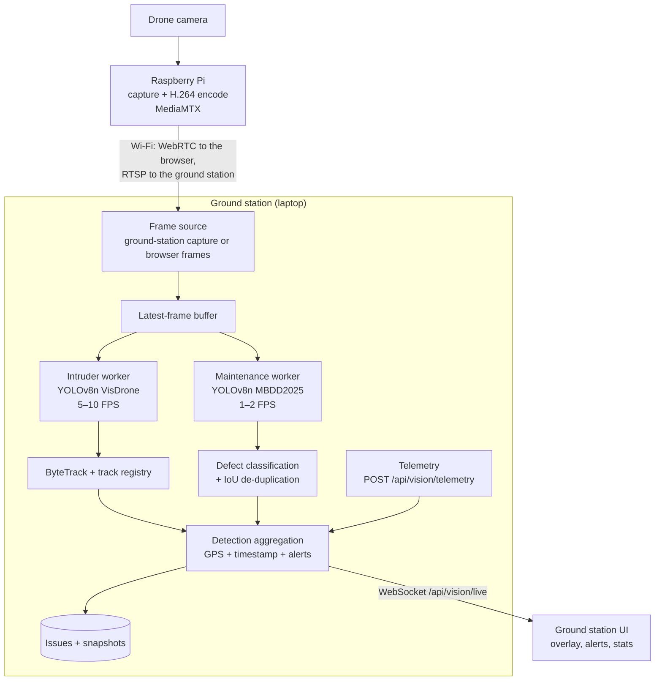

# Live video processing and computer vision

How the ground station runs detection on the drone's video, whether the feed is the live stream from the Pi or a recorded test video. This implements milestone M4 of the [design plan](DESIGN_PLAN.md) with laptop-based inference: the Raspberry Pi captures, encodes, and streams; the laptop runs YOLO, tracking, and reporting.

## Core idea

Video streams continuously, but the detectors only look at selected frames, each at its own rate:

- **Intruder detection**: YOLOv8n (VisDrone) with ByteTrack, 5–10 FPS.
- **Maintenance detection**: YOLOv8n (MBDD2025) with defect classification, 1–2 FPS, mainly in inspection mode.
- **Tracking** keeps each object's identity between inference frames, and the UI moves boxes along each track's velocity between results, so YOLO doesn't have to run on every frame.

## Pipeline



| Plan stage | Code |
|---|---|
| Frame sources | `ground-station/app/vision/sources.py` |
| Latest-frame buffer | `ground-station/app/vision/frames.py` |
| Flight modes and rates | `ground-station/app/vision/modes.py` |
| Workers (one thread per detector) | `ground-station/app/vision/workers.py` |
| YOLO detectors, ByteTrack | `ground-station/app/vision/detectors.py` |
| Track velocity, defect de-duplication | `ground-station/app/vision/tracking.py` |
| Defect classification | `ground-station/app/vision/defects.py` |
| Aggregation, GPS tagging, alerts, auto issues | `ground-station/app/vision/aggregate.py` |
| Session orchestration | `ground-station/app/vision/session.py` |
| REST and WebSocket API | `ground-station/app/api/vision.py` |
| UI: panel, overlay, frame pushing | `web/src/features/vision/` |
| Training, dataset prep, benchmarks | `ground-station/tools/` |

## Works with any feed

Frames reach the latest-frame buffer one of two ways. **Automatic** (the default) picks the right one from the Livestream transport.

| Feed | Automatic picks | How frames arrive |
|---|---|---|
| WebRTC (WHEP) from MediaMTX on the Pi | Ground-station capture | OpenCV reads the same MediaMTX path over RTSP (`http://pi:8889/cam/whep` → `rtsp://pi:8554/cam`). Uses GStreamer when OpenCV is built with it, otherwise FFmpeg with low-latency options. |
| MJPEG | Ground-station capture | OpenCV reads the MJPEG URL. |
| Test video (YouTube import or upload) | Browser frames | The page sends the frames it's showing, so detections follow pause, seek, speed, and frame stepping. |
| Demo feed | Browser frames | Same as test videos. |

Either can be forced in **Processing settings**. Ground-station capture keeps running with the browser tab closed and also works for test videos (read from disk at real-time speed, looping). Browser frames are the fallback when the ground station can't reach the stream itself. They need the tab open, since browsers throttle background tabs. A **capture URL** overrides where the ground station reads the stream, for example a different RTSP path. `DRONE_UI_CAPTURE_PIPELINE` accepts a full GStreamer pipeline ending in `appsink` for setups such as raw RTP/H.264 over UDP. It is environment-only because a pipeline can read and write local files.

The capture thread reads frames as fast as the source delivers them, even when inference is slow. OpenCV queues decoded frames internally, so a reader that only grabs a frame when it needs one gets stale frames.

## Latest-frame buffer

A single slot, not a FIFO queue:

- The source overwrites the slot with every new frame.
- Each worker sleeps until its next slot (1 / target FPS), then takes whatever frame is newest.
- If inference takes longer than the slot, the worker runs back to back, and the frames that arrived in between are skipped rather than queued. Detections never lag behind the video.

The UI shows how many frames were overwritten before any worker took them, and each worker's skipped count. The browser side follows the same rule: it skips a capture tick while the previous frame is still encoding or still in the socket's send buffer.

## Processing modes

The flight mode sets each detector's rate. The defaults below are the plan's initial targets. They're editable per account in **Processing settings**, because the right rates depend on hardware and flight conditions.

| Flight mode | Intruder | Maintenance |
|---|---|---|
| Takeoff / landing | Off | Off |
| Transit | 8 FPS | Off |
| Perimeter patrol | 8 FPS | Off |
| Infrastructure inspection | 3 FPS | 1.5 FPS |
| Return to base | Off (optional, set a rate to enable) | Off |

Mode changes apply to a running session immediately. With **Follow the drone's flight mode** on, the mode switches when telemetry reports one (`takeoff`, `land`, `transit`/`mission`/`auto`, `patrol`, `inspection`, `rtl`/`rtb`, and similar).

## Tracking

Intruder detection runs `model.track(..., persist=True, tracker="bytetrack.yaml")`. Detection runs at a low confidence threshold (0.1) because ByteTrack also associates low-confidence boxes. Only tracks at 0.3 or above are reported. On top of ByteTrack's IDs, the track registry keeps a hit count and a smoothed velocity per track. The UI overlay uses that velocity to keep boxes moving between inference frames (for up to 0.6 s). Each inference pass corrects the position.

Trackers reset whenever old tracks become meaningless: a new source, a reconnect, a seek in a test video (a media-time jump), or detection being switched off and on.

Defects are mostly static and processed at 1–2 FPS, so they use a simple IoU matcher instead. Each physical defect becomes one entry rather than one per frame.

## Defect classification

The MBDD2025 classes (crack, leakage, abscission, corrosion, bulge) are normalized, and each defect is graded:

- Base severity by type. Abscission and bulging are **high**, since detached material can fall. The rest are **medium**.
- One level up if the defect covers 15% of the frame or more. One level down if it's tiny and low-confidence.
- Optional second stage: set `DRONE_UI_DEFECT_CLASSIFIER` to a YOLO classification model (`yolov8n-cls` fine-tuned on defect crops). Its label refines the type, and a severity word in the label (`minor`, `moderate`, `severe`, `critical`) overrides the grade.

## Aggregation, alerts, and GPS tagging

Every inference result goes to the UI as a `detections` event with normalized boxes, the frame's timestamp, media time (for recordings), inference time, end-to-end latency, and the drone position. A detection becomes an **alert** once its track is confirmed: 3 inference frames for intruders, 2 for defects. Each alert:

- Is logged as an issue (`source = "ground"`, tagged **Auto** in the UI) with an annotated snapshot, the GPS position (or the test video timestamp), detector, track, confidence, and flight mode. Operators review it like any other issue.
- Pops up on the feed and refreshes the issue list.

To keep one intruder from filling the log, a new track of the same kind within 15 s (60 s for the same defect type) is held back unless the drone has moved more than 25 m. Auto-logging is capped at 10 issues a minute, and can be turned off.

GPS comes from telemetry. Until the drone link (design plan M2) exists, anything that knows the drone's position can post it:

```bash
curl -X POST http://localhost:8000/api/vision/telemetry \
  -H "Authorization: Bearer $TOKEN" -H "Content-Type: application/json" \
  -d '{"lat": 37.4219, "lon": -122.0841, "alt_m": 30, "heading_deg": 90, "flight_mode": "patrol"}'
```

A fix is attached to detections from frames captured within 5 s of it.

## Live API

| Endpoint | Purpose |
|---|---|
| `GET /api/vision/capabilities` | Whether the vision packages are installed, which models are present, OpenCV/GStreamer support, modes, default rates. |
| `GET` / `PUT /api/vision/settings` | Per-account mode, frame source, capture URL, rates, auto-logging, follow-telemetry. Applies live to a running session. |
| `GET` / `POST` / `DELETE /api/vision/session` | Status, start, stop. One session per account, at most `DRONE_UI_VISION_MAX_SESSIONS` overall. |
| `POST /api/vision/telemetry` | Drone position and flight mode. |
| `WS /api/vision/live` | First message `{"type": "auth", "token": "..."}`. The server sends `status`, `detections`, `alert`, and once a second `stats` events. In browser-frames mode the client sends binary frames: a 4-byte big-endian header length, a JSON header (`ts` ms, `media_time`, `epoch`, `w`, `h`), then the JPEG. |

## Setup

```bash
cd ground-station
# Laptop without an NVIDIA GPU: install the CPU build of PyTorch first (much smaller)
.venv/bin/pip install torch torchvision --index-url https://download.pytorch.org/whl/cpu
.venv/bin/pip install -r requirements-vision.txt
```

On first start, intruder detection downloads the stock COCO `yolov8n.pt` into `ground-station/models/`. Its person and vehicle classes work for testing, but they're trained on ground-level photos. Train VisDrone weights for aerial footage. Maintenance detection stays unavailable until MBDD2025 weights exist.

### Training

```bash
# Intruder detection: Ultralytics downloads and converts VisDrone (~2.3 GB)
.venv/bin/python -m tools.train intruder --epochs 100 --device 0

# Maintenance detection: download MBDD2025 from https://zenodo.org/records/15622584, then
.venv/bin/python -m tools.prepare_mbdd2025 /path/to/MBDD2025 --out datasets/mbdd2025
.venv/bin/python -m tools.train maintenance --data datasets/mbdd2025/mbdd2025.yaml --device 0
```

The trained weights are copied to `models/yolov8n-visdrone.pt` and `models/yolov8n-mbdd2025.pt`, which the ground station prefers automatically. Restart processing in the UI to load them. `prepare_mbdd2025` converts the dataset's Pascal VOC annotations (so the class order is explicit) and makes the paper's 70/20/10 train/val/test split. Training needs a GPU to finish in reasonable time.

### Benchmarking

```bash
# Accuracy: mAP50, mAP50-95, precision, recall, per-class mAP, per-image speed
.venv/bin/python -m tools.benchmark accuracy intruder --data VisDrone.yaml
.venv/bin/python -m tools.benchmark accuracy maintenance --data datasets/mbdd2025/mbdd2025.yaml

# Detector latency and maximum FPS on real footage
.venv/bin/python -m tools.benchmark speed intruder --source flight.mp4

# The whole live pipeline: achieved vs target FPS, end-to-end latency, skipped frames, capture rate
.venv/bin/python -m tools.benchmark pipeline --source rtsp://drone.local:8554/cam --mode inspection --seconds 60
```

Add `--json results.json` to save results. During a session, the **Image processing** panel shows the same live numbers. In browser-frames mode, `stats.ingest_kbps` in the WebSocket stats gives the frame upload bandwidth. For the Wi-Fi video link itself, use MediaMTX's metrics or `iftop` on the laptop.

Reference numbers from a 4-core laptop CPU with no GPU, 1080p footage, `imgsz` 640: YOLOv8n with ByteTrack takes about 125 ms per frame on its own (about 6 FPS maximum). In the live pipeline, where it competes with 1080p decoding, intruder detection reaches about 4 FPS against an 8 FPS target, with about 250 ms end-to-end latency. Expect the targets to be met easily with an NVIDIA GPU (`DRONE_UI_VISION_DEVICE=0`).

## On the Pi (drone repo)

A MediaMTX path serving the camera at 1080p30 over both WebRTC (for the browser) and RTSP (for the ground station):

```yaml
paths:
  cam:
    source: rpiCamera
    rpiCameraWidth: 1920
    rpiCameraHeight: 1080
    rpiCameraFPS: 30
    rpiCameraBitrate: 6000000
    rpiCameraIDRPeriod: 30
```

Set the Livestream transport to WebRTC with `http://<pi>:8889/cam/whep`. The ground station derives `rtsp://<pi>:8554/cam` for processing. A short IDR period helps the decoder recover quickly after Wi-Fi packet loss. As the design plan notes, a Pi 5 has no hardware H.264 encoder, so 1080p30 software encoding uses a lot of its CPU.

The STM32H563ZI stays on flight control and sensor integration. Inference can move onboard later (for example a Pi 5 with a Hailo AI Kit), running the same models and sending `detection` messages over the drone link instead.

## Tuning knobs

| Variable | Default | Purpose |
|---|---|---|
| `DRONE_UI_MODELS` | `ground-station/models` | Where weights are looked up. |
| `DRONE_UI_INTRUDER_MODEL` | `yolov8n-visdrone.pt`, else `yolov8n.pt` | Intruder weights (file name in the models folder, or a path). |
| `DRONE_UI_MAINTENANCE_MODEL` | `yolov8n-mbdd2025.pt` | Maintenance weights. |
| `DRONE_UI_DEFECT_CLASSIFIER` | unset | Optional crop classifier for defect classification. |
| `DRONE_UI_VISION_DEVICE` | auto (first GPU, else CPU) | `cpu`, `0`, `mps`, … |
| `DRONE_UI_VISION_IMGSZ` | `640` | Inference size. VisDrone's small objects benefit from 960–1280 on a GPU. |
| `DRONE_UI_VISION_MAX_SESSIONS` | `2` | Concurrent processing sessions. Each loads its own models. |
| `DRONE_UI_CAPTURE_PIPELINE` | unset | GStreamer pipeline (ending in `appsink`) used for ground-station capture. |
